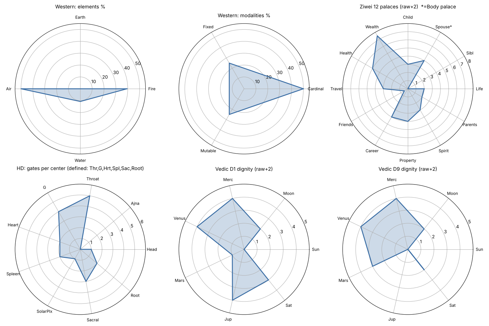
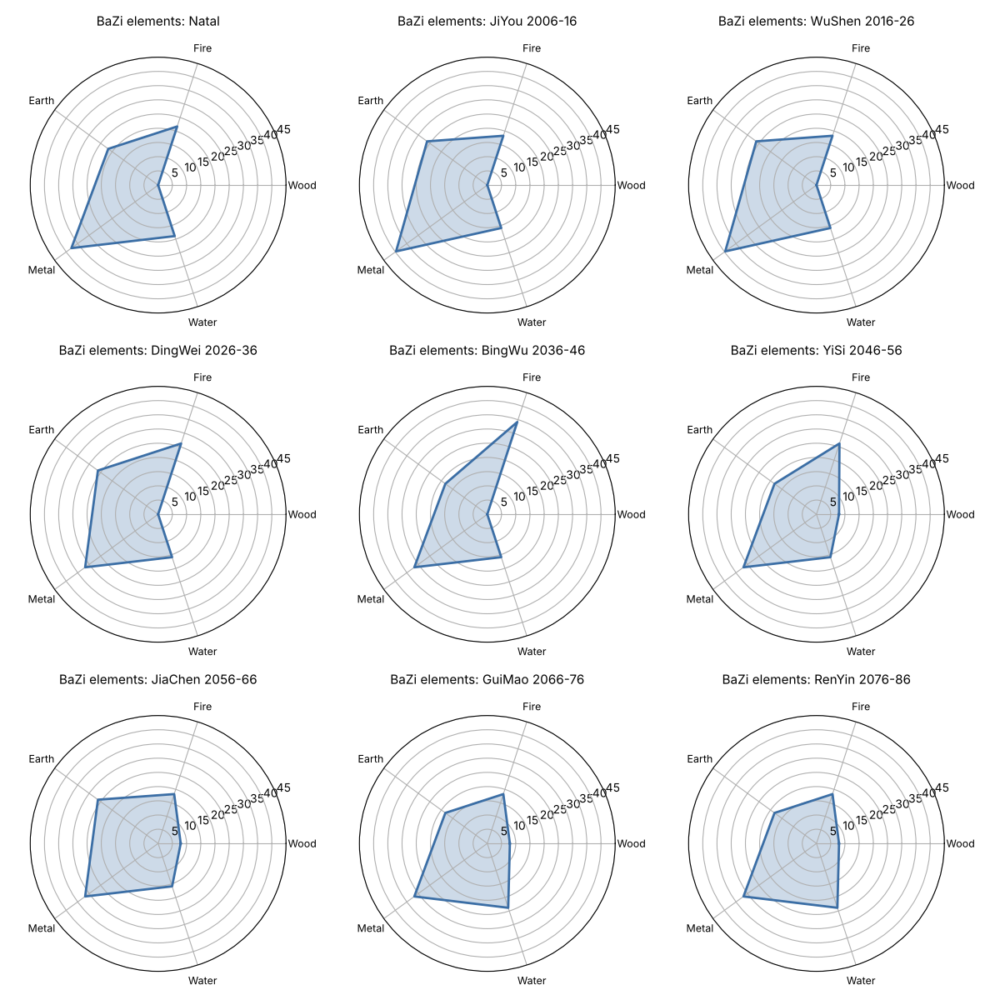
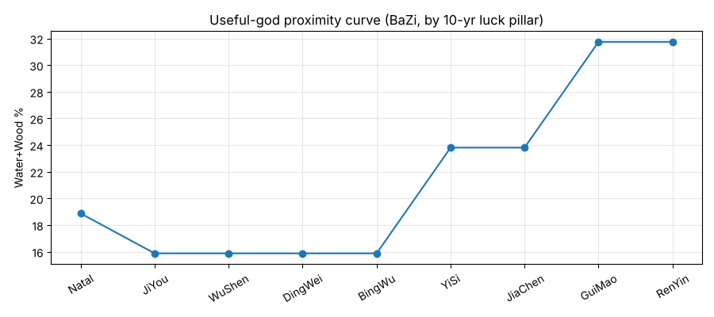
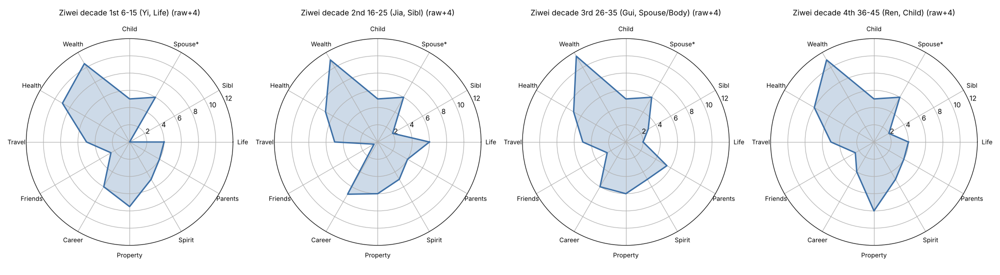

# 多系統命理交叉分析：Bea（v1 + v2 全區塊）

> 輸入：2002-10-20 09:03 PHT（UTC+8）｜Baguio City（16.4023°N, 120.5960°E）｜女
> 計算：Swiss Ephemeris 2.10.03（Moshier 星曆），Lahiri ayanamsa；八字由日柱錨點 1949-10-01＝甲子自行推算，並以 `lunar_python` 交叉驗證；紫微以 `iztro` 排盤並逐項手算核對命／身宮、空劫、火鈴、四化。全部原始碼放在 `calc/`。
> 符號：★★★＝三系統以上匯流；★★＝兩系統；★＝單系統。⚠＝不確定或對時間敏感。

---

## 〇、時間敏感度分析（先講地基穩不穩）

| 項目 | 09:03 結果 | 安全範圍 | 判定 |
|---|---|---|---|
| 真太陽時 | 09:20（均時差 +15.1 分，經度修正 +2.4 分） | — | — |
| 八字時柱／紫微時辰 | 巳時 癸巳 | 真太陽時須晚於 09:00，換算鐘錶時間須晚於 **08:43** | 用真太陽時 ✔（餘裕 20 分）；**若流派用鐘錶時間不做修正，餘裕只有 3 分鐘 ⚠** |
| 西占上升（回歸） | 射手 9°32′ | 約 08:21 之後都是射手 | ✔ |
| 印占上升（恆星） | 天蠍 15°39′ | 08:00–10:00 都是天蠍 | ✔ |
| D9 上升（Vargottama 天蠍） | 天蠍 | 約 08:50–09:07 才成立 | **⚠ 高度敏感，±5 分鐘就變** |
| 北交點合下降點 | 誤差 0.14° | ±3 分鐘 | **⚠ 精準度依賴出生時間** |
| 金星合第 12 宮宮頭 | 誤差 0.008° | ±4 分鐘 | ⚠ |
| HD 個人太陽 50.1 | 進入該爻僅 0.093° | 出生早於約 06:48 會變成 32.6 | ✔（09:03 下穩） |
| HD 設計太陽 56.3 | 進入該爻 0.218° | 約 ±5 小時 | ✔ |
| HD 人生角色 1/3 | 08:03–10:03 全區間不變 | — | ✔ |

**結論**：類型、人生角色、八字四柱、紫微命身宮都穩。所有標「⚠時間」的訊號只能算加分，不能拿來當地基。

---

## 一之零、系統動靜屬性表（v2 區塊 H-1）

| 層 | 內容 | 本報告的寫法 |
|---|---|---|
| L0 恆定 | 八字原局、本命盤相位與宮位、HD 類型／權威／角色／輪迴交叉、命卦、Kin、靈數、紫微本命十二宮 | 「你是」 |
| L1 慢變（10–20 年） | 八字大運、紫微大限、Vimshottari 大運 | 「這段時期你會偏向」 |
| L2 年變 | 流年干支、antardasha、土星回歸等行運 | 「這一年」 |
| L3 情境切換 | 上升（初識）／太陽（意志）／月亮（私下、壓力下）；紫微命宮 vs 身宮；HD 開放中心 | 「在某情境下你會」 |

---

## 一、排盤總表

### 1. 八字（L0）

| | 年 | 月 | 日 | 時 |
|---|---|---|---|---|
| 天干 | 壬（傷官） | 庚（劫財） | **辛（日主）** | 癸（食神） |
| 地支 | 午 | 戌 | 酉 | 巳 |
| 藏干 | 丁 七殺／己 偏印 | 戊 正印／辛 比肩／丁 七殺 | 辛 比肩 | 丙 正官／庚 劫財／戊 正印 |
| 納音 | 楊柳木 | 釵釧金 | 石榴木 | 長流水 |

- 節氣：寒露 2002-10-08 19:09、霜降 10-23 22:17，所以月令是戌月。立春 2002-02-04 08:24，年柱屬壬午年。
- 日主辛金，生在戌月（土生金，得令），日支坐祿（辛祿在酉，屬**專祿日**），月干庚金透出幫身。**身強**（金＋土佔 59.4%，計分方式見 G 節）。
- **木＝0**：天干、地支、藏干裡都沒有木。對辛金來說，木就是財星，所以**原局沒有財星**。
- 格局：月令戌，本氣戊土（正印）。戌中的戊、辛、丁都沒有透干，按本氣取**正印格**；同時壬、癸雙透，帶有「金水傷官」的味道。金水傷官喜歡見官，原局官殺藏在巳、午裡。
- 調候（《窮通寶鑑》九月辛金）：先用壬、再取甲。壬已透（年干），**甲完全沒有**。
- 喜用：**喜水、木，火次之；忌土、金**。
- 合沖刑害：巳酉半合金、午戌半合火、酉戌相害。
- 神煞：天乙貴人（午）、將星（年支午、日支酉，**兩見**）、華蓋（戌）、桃花（午，從日支起）、紅艷（酉，坐日支）、**陰差陽錯（日柱辛酉、時柱癸巳，兩見）**、亡神（巳）。月柱庚戌是魁罡柱。羊刃在戌屬陰干取刃，流派有爭議，標 ⚠。空亡：子、丑（原局沒有）。
- 大運（陽年女命，逆排，2006-08-30 起運，兩套計算一致）：
  己酉 2006–2016｜戊申 2016–2026｜**丁未 2026.08–2036**｜丙午 2036–2046｜乙巳 2046–2056｜甲辰 2056–2066｜癸卯 2066–2076｜壬寅 2076–2086。

### 2. 紫微斗數（L0）

- 農曆：壬午年九月十五日巳時。前一次朔是 2002-10-06 19:17，九月以霜降為中氣，2002 年無閏月。
- 五行局：火六局。命主武曲，身主火星。

| 宮 | 干支 | 主星 | 輔煞 | 四化 |
|---|---|---|---|---|
| **命宮** | 乙巳 | 廉貞（陷）、貪狼（陷） | 文昌（廟）、天鉞 | — |
| 兄弟 | 甲辰 | 太陰（陷） | 地劫 | — |
| **夫妻（身宮）** | 癸卯 | 天府（得） | 天魁 | — |
| 子女 | 壬寅 | — | 右弼 | — |
| 財帛 | 癸丑 | 紫微（廟）、破軍（旺） | — | **紫微化權** |
| 疾厄 | 壬子 | 天機（廟） | 左輔、擎羊（陷） | 左輔化科 |
| 遷移 | 辛亥 | — | 祿存 | — |
| 交友 | 庚戌 | 太陽（不） | 陀羅 | — |
| 官祿 | 己酉 | 武曲（利）、七殺（旺） | 文曲（廟） | **武曲化忌** |
| 田宅 | 戊申 | 天同（旺）、天梁（陷） | 天馬、鈴星 | 天梁化祿 |
| 福德 | 丁未 | 天相（得） | — | — |
| 父母 | 丙午 | 巨門（旺） | 地空、火星 | — |

- 結構重點：
  - 命宮三方四正是廉貪、紫破、武殺：**殺破狼格**。
  - 命宮左鄰辰（地劫）、右鄰午（地空、火星）：**空劫夾命**。
  - 文昌在命、文曲在官祿：昌曲拱命。
  - **命主星武曲本身化忌**，坐官祿宮。
  - **身宮落夫妻宮**。

### 3. 西洋占星（回歸黃道、Placidus；L0）

| 星體 | 位置 | 宮位 | 備註 |
|---|---|---|---|
| 太陽 | 天秤 26°28′ | 11 | 落陷（fall） |
| 月亮 | 牡羊 12°46′ | 4 | |
| 水星 | 天秤 10°33′ | 10 | |
| 金星 | 天蠍 13°53′ ℞ | 11（**合第 12 宮宮頭，誤差 0.008°** ⚠時間） | 失勢（detriment）＋逆行 |
| 火星 | 天秤 2°44′ | 10 | 失勢 |
| 木星 | 獅子 14°57′ | 9 | |
| 土星 | 雙子 29°01′ ℞ | 7 | 最末度數（29°） |
| 天王 | 水瓶 25°00′ ℞ | 3 | |
| 海王 | 水瓶 8°11′ ℞ | 2 | |
| 冥王 | 射手 15°41′ | 1 | |
| 北交點（真） | 雙子 9°24′ | 6／7 交界 | **合下降點 0.14°** ⚠時間 |
| 上升／天頂 | 射手 9°32′／處女 13°21′ | | |

- 精準相位（容許度 ≤1.1°）：
  - 北交點合下降點 0.14°
  - 金星六合天頂 0.53°
  - 月亮十二分之五天頂 0.60°
  - 木星三分冥王 0.73°
  - 水星六合上升 1.01°
  - 金星四分木星 1.07°
- 圖形：
  - **風象大三角**：太陽、土星、天王（容許度 2.6°／4.0°／1.5°）。
  - **火象大三角**：月亮、木星、冥王，加上上升點。
  - 水星對分月亮（2.2°），形成鳶形的尾端（水星六合冥王 5.1°，偏鬆 ⚠）。
  - 火星四分土星 3.7°。
- **太陽只跟土星、天王（社會性、集體性行星）有相位，跟月亮、水星、金星、火星這些個人行星都沒有相位。**
- 沒有完全無相位的行星。

### 4. 印度占星（Lahiri，整宮制；L0）

| 星體 | 恆星黃道位置 | 宮 | 星宿 | D9 | 尊貴 |
|---|---|---|---|---|---|
| Lagna | 天蠍 15°39′ | 1 | Anuradha 4 | 天蠍（Vargottama ⚠時間） | |
| 太陽 | 天秤 2°34′ | 12 | Chitra 3 | 天秤 | **入弱＋Vargottama**（Neecha Bhanga 成立，見下） |
| 月亮 | 雙魚 18°52′ | 5 | **Revati 1** | 射手 | 中性 |
| 水星 | 處女 16°39′ | 11 | Hasta 2 | 金牛 | **入旺＋入廟（距最旺點 1.65°）** |
| 金星 | 天秤 19°59′ ℞ | 12 | Swati 4 | 雙魚（D9 入旺） | 入廟 |
| 火星 | 處女 8°51′ | 11 | U.Phalguni 4 | 雙魚 | 敵宮（Lagna 主星） |
| 木星 | 巨蟹 21°04′ | 9 | Ashlesha 2 | **摩羯（D9 入弱）** | **入旺**；Atmakaraka |
| 土星 | 雙子 5°07′ ℞ | 8 | Mrigashira 4 | 天蠍 | 友宮 |
| Rahu（真） | 金牛 15°31′ | 7 | Rohini 2 | 金牛（Vargottama） | |
| Ketu | 天蠍 15°31′ | **1** | Anuradha | | |

- 業力指標星（Karaka）：AK 木星（21°04′）、AmK 金星、DK 太陽。Karakamsa 落摩羯。
- 瑜伽：
  - **Neecha Bhanga**：太陽入旺星座的主星火星，位於月亮起算的角宮（第 7）。
  - **Vimala**：12 宮主金星坐 12 宮。
  - **Kemadruma 成格但被解除**：月亮前後兩宮都沒有行星，但土星、水星、火星在月亮的角宮。
  - Bhadra 只從月亮起算時成立（水星在月亮的第 7 宮入旺）。標 ⚠，正統只從 Lagna 起算。
- **Lagna 的四個角宮裡沒有任何七曜行星，只有兩個交點。**
- 木星同時相照 Lagna 和月亮。月亮同時受木星、土星、火星三星相照。
- Vimshottari 大運（月亮在 Revati，年長 365.2425 日）：
  水星 1999-12 → 2016-12｜計都 2016-12 → 2023-12｜**金星 2023-12 → 2043-12**｜太陽 2043 → 2049｜月亮 2049 → 2059。
  金星大運裡的小運：金／金至 2027-04｜金／日 2027-04｜金／月 2028-04｜金／火 2029-12｜金／羅睺 2031-02｜金／木 2034-02｜金／土 2036-10｜金／水 2039-12。

### 5. 人類圖（L0）

- 設計時刻：2002-07-21 17:43 PHT。
- 閘門（個人／設計）：

| 星體 | 個人 | 設計 |
|---|---|---|
| 太陽 | 50.1 | 56.3 |
| 地球 | 3.1 | 60.3 |
| 月亮 | 21.4 | 26.6 |
| 北交點 | 16.4 | 45.1 |
| 南交點 | 9.4 | 26.1 |
| 水星 | 48.2 | 56.3 |
| 金星 | 1.1 | 64.1 |
| 火星 | 46.5 | 31.4 |
| 木星 | 7.2 | 56.2 |
| 土星 | 15.1 | 12.2 |
| 天王 | 30.1 | 30.4 |
| 海王 | 19.1 | 19.3 |
| 冥王 | 5.5 | 5.5 |

- 通道：3-60（突變）、5-15（韻律）、7-31（創始者）、16-48（才華）、21-45（金錢）。
- 中心：
  - 已定義：喉嚨、G、意志力（心）、直覺（脾）、薦骨、根部。
  - 未定義：頭頂（有閘門 64）、情緒（有閘門 30）。
  - **完全空白：邏輯中心（Ajna）**。
- **類型：生產型顯示者（MG）**。薦骨透過 5-15 接到 G，再透過 7-31 接到喉嚨；意志力也透過 21-45 直接接到喉嚨。
- **權威：薦骨。人生角色：1/3。一分人**（單一定義）。
- **輪迴交叉：右角度交叉之律法（50/3｜56/60）**。
- 交點用真交點。若改用平均交點，個人北交點會是 16.6、設計北交點 35.5，不影響通道。
- Gene Keys 四正：
  - 50（陰影 腐敗 → 天賦 平衡 → 悉地 和諧）
  - 3（混亂 → 創新 → 天真）
  - 56（分心 → 豐富 → 陶醉）
  - 60（限制 → 務實 → 公正）

### 6. 其他系統

| 系統 | 結果 | 層 |
|---|---|---|
| 生命靈數 | 主命數 **7**（2+0+0+2+1+0+2+0），沒有卓越數；生日數 2（20 日）；態度數 3；塔羅生日牌 **戰車（VII）**（2002+10+20=2032 → 7） | L0 |
| 八宅命卦 | 女命 2002 → **艮八，西四命**（土） | L0 |
| 九星氣學 | 本命星 **七赤金星**；月命星 **九紫火星**（戌月，子午卯酉年起八白逆排） | L0 |
| 馬雅曆 | **Kin 135：超頻的藍鷹**（Overtone Blue Eagle）；波符：藍猴；指引：藍夜；類比：黃種子；對立：紅蛇；隱藏：白世界橋（2013-07-26＝Kin164 反推 3932 天，扣 3 個 2/29） | L0，**詩性層** |

排除的系統：
- MBTI、九型人格：需要自陳量表，無法從出生資料推得。
- 姓名學：只有英文暱稱，沒有中文名。
- 河洛理數：流派分歧大，寧缺勿錯。

**交叉的獨立性規則（本報告自訂，先講清楚，以免灌水）**：
- 西占和印占用的是同一片天。同一顆星、同一個星座的事實只算一個來源。例如「北交點合下降點」和「Rahu 在 7 宮」是同一件事，只計一次。
- 八字和九星都從干支曆推出來，五行重疊時算半個來源。
- 靈數和馬雅曆只算佐證，不能湊成三系統匯流。

---

## 一之二、量化總覽（v2 區塊 G）



**計分規則（完整揭露）**

- **八字五行**：
  - 天干每個 1.0。
  - 地支本氣 1.0（月支本氣 ×1.5）、中氣 0.5、餘氣 0.3。
  - 藏干順序採 lunar_python 慣例：午＝丁己；戌＝戊辛丁；酉＝辛；巳＝丙庚戊。
- **西占**：
  - 日、月、上升各 2.0；水、金、火各 1.5；木、土各 1.0；天、海、冥各 0.5。
- **紫微**：
  - 主星：廟、旺 +2；平 0；陷 −1。另外延伸：得、利 +1，不 −0.5。
  - 四化：祿 +2、權 +1.5、科 +1、忌 −2。
  - 六吉各 +1、六煞各 −1。另外延伸：祿存 +1。
  - 圖上整體平移 +2，讓負值也能畫出來。
- **HD**：九個中心的閘門數量（不分個人或設計）。
- **印占**：
  - 入廟或入旺 +2、友宮 +1、中性 0、敵宮 −1、入弱 −2。
  - 落在角宮再 +1（本盤沒有任何行星得到這一分）。
  - 交點不計。D1、D9 各算一次。

**八字五行（本命）**

```
金 ███████░░░ 37.7%
火 ████░░░░░░ 21.7%
土 ████░░░░░░ 21.7%
水 ███░░░░░░░ 18.9%
木 ░░░░░░░░░░  0.0%
```

- 資產面：金強代表判斷銳利、標準清楚、能切割，自己就是自己的資源（專祿）。
- 負債面：容易用切斷代替協商。**木（財、對外經營、累積、彈性）完全缺席。**

**西占元素與模式**

```
風 █████░░░░░ 50.0%      基本 █████░░░░░ 50%
火 ████░░░░░░ 39.3%      固定 ███░░░░░░░ 25%
水 █░░░░░░░░░ 10.7%      變動 ███░░░░░░░ 25%
土 ░░░░░░░░░░  0.0%
```

- 資產面：概念快、社交快、能發起（基本宮佔 50%）。
- 負債面：**土元素 0%**，「把東西落地成可維持的形態」不是她的預設模式。水只靠一顆逆行的金星撐著。

**紫微十二宮（原始分）**

```
財帛 +5.5 ███████████
疾厄 +3.0 ██████
夫妻 +2.0 ████   ← 身宮
官祿 +2.0 ████   （武殺分數雖高，但含化忌 −2）
田宅 +2.0 ████
子女/遷移/福德 +1
命宮 0（兩顆主星都陷，靠昌、鉞補回）
父母 0
交友 −1.5
兄弟 −2.0
```

**HD 中心**

| 中心 | 狀態 | 閘門數 |
|---|---|---|
| 喉嚨 | 已定義 | **5（最高）** |
| G | 已定義 | 4 |
| 薦骨 | 已定義 | 3 |
| 意志力 | 已定義 | 2 |
| 直覺 | 已定義 | 2 |
| 根部 | 已定義 | 2 |
| 頭頂 | 未定義 | 1 |
| 情緒 | 未定義 | 1 |
| 邏輯（Ajna） | **全空** | 0 |

**印占行星力**

| | D1 | D9 |
|---|---|---|
| 太陽 | −2 | −2 |
| 月亮 | 0 | 0 |
| 水星 | +2 | +2 |
| 金星 | +2 | +2 |
| 火星 | −1 | +1 |
| 木星 | **+2** | **−2** |
| 土星 | +1 | 0 |

- 水星和金星兩盤都強，是靈魂層穩定的資產。
- 木星從 D1 入旺翻成 D9 入弱，是本盤最大的內外反差。

**靈數 1–9 頻次**：0 ×4、1 ×1、2 ×3，3 到 9 全部缺席。主命數 7 是加總得出的，不是盤面上出現的數字。

**跨圖對讀**：
- 「說和寫」這一軸在四張圖上都是高峰：八字食傷雙透、HD 喉嚨 5 閘門、印占水星兩盤入旺、紫微文昌文曲雙廟。
- 「落地、累積」這一軸在兩張圖上是零：八字木 0、西占土 0。這兩個零是不同的概念，但功能指向相同。
- 這不是「她又理性又感性」那種多面性。它是一種很具體的不對稱：**輸出強，轉存弱**。

---

## 二、頭條發現

### 頭條一：身分層是「天秤／關係」，體質層是「辛金／切割」（★★★）

- **身分層**（她認同自己是誰、想成為什麼樣的人）：
  - 西占：太陽天秤，連同水星、火星共三星落天秤。北交點合下降點 0.14° ⚠時間。
  - 紫微：**身宮落夫妻宮**。
  - 八字：陰差陽錯兩見，紅艷坐日支。
  - 印占：Rahu 在 7 宮。跟西占北交點是同一件天文事實，只計一次。
  - 合起來看，她的身分是**在關係裡、透過對方這面鏡子**建立起來的。
- **體質層**（真正負責運轉的那台引擎）：
  - 八字：辛金專祿，金 37.7%，月柱庚戌魁罡，劫財透出。
  - 西占：月亮牡羊。
  - 印占：Lagna 天蠍，Ketu 坐命。
  - 紫微：命宮在殺破狼格局裡。
  - 合起來看，這是一台**自足、銳利、處理摩擦的方式是切斷而不是磨合**的機器。

**這解釋了為什麼重複**：她選了一個「和諧、公平、關係導向」的身分專案，卻裝在一台處理摩擦靠「切」的引擎上。
1. 身分層讓她在摩擦初期**選擇吞下**。吞下符合「我是講理、好相處的人」這個自我形象，所以吞的時候感覺像美德，而不是問題。
2. 帳記在內部：金星逆行在天蠍、金星貼近 12 宮宮頭、印占金星在 12 宮。
3. 累積到閾值時，由體質層接手：月亮牡羊、薦骨權威、辛金，**一刀斷**。
4. 斷完之後，身分層又回到「我是講理的人」。下一輪開始。

這個循環**在每個階段都符合她的自我形象**，所以不會被當成問題看見。

### 頭條二：輸出端過載，轉存端缺席（★★★，但有反證，見第七節）

- 輸出端：
  - 八字：食神、傷官雙透。
  - 印占：水星入旺（距最旺點 1.65°）。
  - HD：喉嚨 5 個閘門，3 條通道接進喉嚨。
  - 紫微：文昌、文曲雙廟。
- 轉存端：
  - 八字：財星（木）＝0。
  - 西占：土元素 0%，海王在 2 宮。
  - 紫微：財星武曲化忌，而且**武曲就是命主星**。
- 「產出」和「把產出變成存量」之間的管線，是本盤結構性的斷點。

---

## 三、本質層：十個核心機制

每一條都依序寫：機制｜來源｜為何重複｜為何「提醒自己別做」無效。

**M1　先吞後斷**（★★★）
- 機制：摩擦先被吸收，在內部記帳，到閾值後一次性切斷，關係、工作、計畫都適用。中間幾乎沒有「漸進式協商」這一段。
- 來源：
  - 西占：太陽落陷、火星失勢都在天秤；金星逆行失勢在天蠍。
  - 八字：辛金專祿、劫財透、月柱魁罡。
  - 紫微：殺破狼，破軍在財帛。
  - HD：第 3 爻（關係建立又打破）；情緒中心開放。
  - 印占：Ketu 坐命。
- 為何重複：吞的階段跟身分層一致，所以感覺是美德；斷的階段由身體決策（薦骨、牡羊月亮），比思考快。
- 為何提醒無效：「下次早點講」這個提醒存在 Ajna，而她的 Ajna 是全空的。真正下決定的是薦骨，在提醒介入之前就完成了。

**M2　身分在鏡子裡成形**（★★★）
- 機制：她對自己的定義，跟當下最重要的那段關係（伴侶、合作者、導師）高度同步。關係一換，自我敘事跟著改版。
- 來源：
  - 紫微：身宮落夫妻宮，命宮廉貪是桃花主星。
  - 西占：北交點合下降點（印占 Rahu 在 7 宮是同一事實），太陽在天秤。
  - 八字：陰差陽錯兩見，紅艷、桃花。
- 為何重複：北交點在下降點，在象徵上就是「人生的成長方向就是對方」。不往那裡走會覺得停滯，往那裡走又會失去自己的輪廓。
- 為何提醒無效：「做自己」這句話預設有一個不依賴關係的自己可以回去。這張盤的身宮本來就放在夫妻宮。

**M3　輸出強，轉存弱**（★★★，有反證）
- 機制：靠說、寫、分析賺取注意力或報酬的能力明顯高於把報酬留存下來的能力。存款、作品集、可重複使用的資產，跟產出量不成比例。
- 來源：
  - 八字：食傷雙透，木＝0。
  - 西占：土 0%，海王在 2 宮，金星逆行。
  - 紫微：命主武曲化忌坐官祿。
- 為何重複：辛金加上壬水（金白水清）的價值感來自「被淘洗得發亮」，也就是表現本身，而不是囤積。
- 為何提醒無效：「要存錢」是在跟價值感對抗。對這張盤來說，存下來的東西不會帶來被淘洗的感覺。

**M4　研究先行，研究即鎮定劑**（★★★）
- 機制：承諾之前要先挖到底。研究的功能不只是收集資訊，更是**降低不安**。
- 來源：
  - HD：第 1 爻（研究者），閘門 48（深度，恐懼不足）。
  - 靈數：主命數 7。
  - 印占：水星在處女座入旺。
  - 西占：天頂處女。
  - 八字：正印格。
- 為何重複：第 1 爻的不安只能靠「知道」來消除，所以研究本身就帶來獎賞。
- 為何提醒無效：「少想多做」是要她拿掉鎮定劑，卻沒有給替代品。

**M5　爆發式起動，七成處踩剎車**（★★★）
- 機制：起頭極快，會跳過步驟。進度到中段就撞到結構性阻力，常在大約七成的地方停下或轉向。
- 來源：
  - HD：生產型顯示者（MG）。
  - 西占：基本宮 50%，月亮牡羊，**火星四分土星 3.7°**。
  - 紫微：殺破狼主開創。
- 為何重複：MG 的薦骨回應是即時的，火土四分是內建的剎車。兩者都是 L0。
- 為何提醒無效：「要有始有終」把停下來看成意志問題，但它其實是油門和剎車的配置問題。

**M6　別人的情緒會被放大成自己的決策壓力**（★★★）
- 機制：在別人情緒高漲的場合，她會做出事後不認同的讓步或決定。
- 來源：
  - HD：情緒中心開放，只有閘門 30 掛著。
  - 印占：月亮同時受火星、土星、木星三星相照。
  - 西占：月亮對分水星，太陽在天秤。
- 為何重複：開放的中心會放大進來的訊號，而且放大後的感覺分不出是誰的。
- 為何提醒無效：情緒當下還沒有「這不是我的」這個標籤，事後回想才分辨得出來。

**M7　想掌控資源與地盤**（★★★）
- 機制：明確想要「這一塊由我管」，包括預算、專案、空間。被干預時，反應比一般人大。
- 來源：
  - HD：21-45 金錢通道；個人月亮落閘門 21（獵人，掌控）。
  - 紫微：紫微化權在財帛。
  - 八字：劫財透（爭財）。
  - 印占：Lagna 主星火星坐 11 宮。
- 為何重複：它跟 M3 是一組。原局「守不住」，所以要靠「管得到」來補償。
- 為何提醒無效：叫她「放手」，等於拿掉 M3 唯一的補償機制。

**M8　標準即盔甲**（★★★）
- 機制：對品質、措辭、細節的要求遠高於周遭的人。被批評時，被刺痛的不是那件事，而是「我不夠深」。
- 來源：
  - 八字：辛金是珠玉之金。
  - HD：閘門 48（深度與不足感）、閘門 50（價值與守則）。
  - 印占：水星在處女座入旺。
  - 西占：天頂處女。
- 為何重複：高標準讓她不必面對第 1 爻的不安。
- 為何提醒無效：「不用那麼完美」聽起來像是在叫她卸掉盔甲上戰場。

**M9　方向型領導，但需要被邀請**（★★）
- 機制：在團體裡，她常常自然變成指出方向的人。如果沒有被正式承認，會轉為怨氣。
- 來源：
  - HD：7-31 創始者通道，G 中心定義（5-15、7-31）。
  - 八字：將星兩見。
- 為何重複：7-31 屬於投射性的領導力，需要被看見才能運作。
- 為何提醒無效：「主動爭取」違反這條通道的運作方式，「等就好」又違反 MG 的本性。

**M10　一條不公開的私人生活線**（★★★）
- 機制：她有一塊別人很少看到的私人區域（創作、靈性、享受、花費），而且刻意不公開。
- 來源：
  - 印占：太陽、金星同坐 12 宮，Ketu 坐命。
  - 西占：金星貼第 12 宮宮頭 ⚠時間。
  - 八字：華蓋（戌）。
- 為何重複：12 宮的金星會把「價值」藏進私人領域。
- 為何提醒無效：這不是缺點，不需要提醒。真正的問題是資源（M3）也可能跟著流進這個看不見的地方。

---

## 四、結構層

### 人格分層（L3 情境 × 部件）

| 層 | 部件 | 樣貌 |
|---|---|---|
| 外殼（初識） | 西占上升射手、冥王坐 1 宮；紫微命宮廉貪＋文昌 | 爽朗、有見地、帶一點魅力和強度 |
| 意志 | 天秤太陽（落陷）；印占太陽入弱但 Vargottama 並且 Neecha Bhanga | 想要公平、想被承認，但不直接爭取 |
| 私下 | 牡羊月亮、印占雙魚月亮（Revati） | 快、直接、沒耐心。同時另一層又很容易被感染（座標系差異，見第七節） |
| 引擎 | 辛金專祿、HD 薦骨 | 能量自足，靠身體判斷 |
| 輸出 | 食傷雙透、喉嚨 5 閘門、水星 | 說和寫 |

### 純盤面天賦（每項附來源）

1. 把複雜的東西說清楚。來源：印占水星入旺、八字傷官、HD 16-48、紫微昌曲。★★★
2. 在混亂中建立秩序與規則。來源：HD 輪迴交叉律法、個人地球閘門 3、Gene Key 3 的天賦是「創新」；印占木星入旺 9 宮（法、教）。★★
3. 掌管資源與預算的意志力。來源：HD 21-45、紫微紫微化權在財帛。★★
4. 故事化與刺激他人。來源：HD 設計端閘門 56 出現三次（太陽、水星、木星）；Gene Key 56 的天賦是「豐富」。★（只來自 HD）

---

## 五、陰影層：十條可證偽的盲點

1. 至少有一段重要關係（伴侶、朋友或工作），是她在長期**沒有明說不滿**之後主動結束的，而且對方事後形容那次結束很「突然」。（M1）
2. 回顧最近三段重要關係或合作，她在每一段裡的自我介紹、興趣排序、穿著或語言風格都有明顯改版。（M2）
3. 她說話、寫作或做分析得到的稱讚，**早於而且多於**她在其他能力上得到的稱讚。（M3、M4）
4. 她有一筆或一類支出是**不讓親近的人知道的**。（M10＋M3）
5. 她手上至少有一個主題，已經研究、收藏或買課超過三個月，但還沒開始做。（M4）
6. 她參與過的專案，以「做到七、八成時轉向或停擺」收場的比例，高於「完整結案」的比例。（M5）
7. 她曾在別人激動的場合當場答應某件事，事後反悔或私下抱怨。（M6）
8. 共享空間或共同預算被別人擅自動過時，她的反應強度會讓旁人覺得「這有那麼嚴重嗎」。（M7）
9. 只認識她一陣子的人會形容她隨和；認識她很久的人會形容她標準很高，甚至嚴苛。（頭條一）
10. 她曾經實際上在帶方向，卻沒有被正式承認，因此累積怨氣，最後用退出收場。（M9＋M1）

---

## 六、誤判層

**以為是天賦，其實可能是逃避**
- **研究力**（M4）：它往往在替「還不想承擔第 3 爻的試錯代價」找理由。
- **體貼與好相處**（天秤太陽）：它可能是在延後衝突，不是在化解衝突。
- **說得好**（M3）：說和寫有時會取代做，把「說出來」誤當成「完成了」。
- **獨立、不求人**（專祿日、Ketu 坐命）：這可能是在迴避 7 宮的成長方向，也就是北交點和 Rahu 要她走的那條路。

**以為是限制，其實可能是保護**
- **財星缺席、守不住錢**：它也讓她不會被財物綁住，可以快速轉向（殺破狼需要這種輕）。真正要做的是外接一個存的管線，而不是補成另一個人。
- **邏輯中心全空、下不了結論**：這其實讓她能同時看見多個觀點，前提是最後交給薦骨決定。
- **斷得快**（M1）：它保護她不被耗盡的關係吞掉。問題不在於會斷，而在於斷之前那一段太長。
- **私人生活線**（M10）：對一個身分在鏡子裡成形的人來說，這是唯一不被鏡子定義的地方。

---

## 七、匯流與矛盾

### 匯流表（★★★）

| 結構 | 八字 | 紫微 | 西占 | 印占 | HD | 其他 |
|---|---|---|---|---|---|---|
| 先吞後斷 | 辛金、劫財、魁罡 | 殺破狼 | 天秤火星、天蠍逆行金星 | Ketu 坐命 | 第 3 爻、情緒開放 | — |
| 鏡中身分 | 陰差陽錯 ×2 | 身宮在夫妻宮 | 北交點合下降點 | （與西占同源） | — | — |
| 輸出強、轉存弱 | 食傷雙透、木 0 | 武曲化忌（命主） | 土 0、海王 2 宮 | 水星入旺 | 喉嚨 5 閘門 | — |
| 研究先行 | 正印格 | — | 天頂處女 | 水星在處女 | 第 1 爻、閘門 48 | 靈數 7 |
| 爆發加剎車 | — | 殺破狼 | 基本宮 50%、火星四分土星 | — | MG | — |
| 情緒被放大 | — | — | 月亮對分水星 | 月亮受三星相照 | 情緒中心開放 | — |
| 掌控資源 | 劫財透 | 紫微化權在財帛 | — | 火星坐 11 宮 | 21-45 | — |
| 私人生活線 | 華蓋 | — | 金星合 12 宮宮頭 ⚠ | 太陽、金星在 12 宮 | — | — |
| **2016–17、2026–27、2036–37 三度同步換軌** | 大運交接 | 大限交接 | — | dasha 或 antardasha 交接 | — | 見第八節 |

### 矛盾清單

1. **上升射手（回歸）vs 天蠍（恆星）**
   - 判定：**假衝突**，是座標系差異（歲差 23.9°）。
   - 調和：回歸盤透過冥王合上升（6.1°）把天蠍的強度帶進第一宮，兩盤其實說的是同一件事：外表射手，內核天蠍。
2. **錢：八字財 0、西占土 0 vs 紫微財帛最強（紫破化權）、印占 2 宮主木星入旺、11 宮水星入旺**
   - 判定：**真對立，但分屬不同層次**。
   - 紫微和印占描述的是「賺取與掌控的能力」。八字和西占描述的是「原生的持有感與累積模式」。
   - 可檢驗的預測：收入有明顯的高峰，但留存率不跟著高峰成比例上升；淨值增長主要來自外在的強制結構（自動扣款、伴侶、制度）。如果她的實際紀錄是「一路穩定累積」，就該調降 M3 的權重。
3. **太陽弱（西占落陷、印占入弱，同一天文事實）vs 八字日主身強 59%**
   - 判定：**真對立，可以並存（軸向並存）**。
   - 八字日主量的是「能量與資源的自足程度」。占星太陽量的是「公開的自我主張與被承認的程度」。
   - 合起來：**內部很強，外部不顯**。這也正是 M9「需要被邀請」的成因。
4. **印占木星 D1 入旺 vs D9 入弱（木星是 AK，靈魂指標）**
   - 判定：**真對立，屬於時期並存**。
   - D1 是外在能見度：理念、導師、信念系統都顯得很強。D9 一般被視為中年以後和內在的層次：信念的根基比外表脆弱。
   - 推測：二十多歲時信的東西，三十多歲以後會經歷一次去偶像化。
5. **HD 邏輯中心全空、頭頂未定義 vs 印占水星入旺、紫微文昌廟、八字傷官**
   - 判定：**假衝突，屬於軸向並存**。
   - 表達與分析能力高，跟概念上的確定感低，是兩條獨立的軸。
   - 表現出來的樣子：能把五種觀點都講得很好，但很難宣布「我選這個」。
6. **西占月亮牡羊（快、直接）vs 印占月亮雙魚 Revati（易感、會滲透）**
   - 判定：座標系差異，**不能兩者都當真**。
   - 本報告的處理：
     - 西占月亮牡羊有火象大三角支持，作為「反應速度」。
     - 印占月亮受三星相照，作為「易被干擾」。
     - 兩者都沒有被第三個系統獨立指向，所以都只標 ★★。
7. **紫微命宮廉貪雙陷，又被空劫夾 vs 八字專祿身強**
   - 判定：**屬於不同層次**。
   - 八字講引擎強。紫微命宮講外在形象和命運容器不穩，是「強引擎、浮動底盤」。
   - 這跟第 3 項一致，屬於匯流，不算衝突。
8. **HD 薦骨權威（當下用身體決定）vs 第 1 爻、靈數 7（研究）**
   - 判定：**情境並存**。研究提供背景知識，決定權在薦骨。兩者順序顛倒的時候，就會出現 M4 的陷阱。
9. **八宅命卦艮土（西四命）vs 八字忌土**
   - 判定：**假衝突**。命卦用來決定方位、做風水選擇，不是五行喜忌。兩者不在同一個層面上比較。

---

## 八、時間層

### 三條長波對齊

| 期間（約） | 八字大運 | 紫微大限（虛歲） | Vimshottari | 判讀 |
|---|---|---|---|---|
| 2006–2016 | 己酉（印、比，忌） | 6–15 命宮（乙：太陰忌在兄弟） | 水星（到 2016-12） | 童年：學習快，同儕、手足線有傷 |
| **2016–2026** | **戊申（印、劫，忌）** | **16–25 兄弟（甲：太陽忌在交友）** | **計都 2016-12 → 2023-12** | **三系統同步換軌**：身分霧化、同儕壓力、看不見自己 |
| **2026–2036** | **丁未（七殺、偏印；丁壬合；未藏乙木，第一次出現財）** | **26–35 夫妻／身宮（癸：破軍祿在財帛、貪狼忌沖命）** | **金星 2023–2043**（AmK，7 宮主與 12 宮主） | **換軌窗口**：關係和事業同時成為主場 |
| 2036–2046 | 丙午（官殺當令；丙辛合日主） | 36–45 子女（壬：武曲忌疊本命忌） | 金／土 2036-10 起 | 第三次同步換軌：權責、承諾加重 |
| 2046–2056 | 乙巳（偏財第一次透干，但乙庚合被劫） | 46–55 財帛 | 金／水 → 太陽 2043 | 財路第一次浮上檯面 |





**用神接近度曲線**（水＋木佔比）：

| 本命 | 己酉 | 戊申 | 丁未 | 丙午 | 乙巳 | 甲辰 | 癸卯 | 壬寅 |
|---|---|---|---|---|---|---|---|---|
| 18.9 | 15.9 | 15.9 | 15.9 | 15.9 | 23.8 | 23.8 | 31.7 | 31.7 |

- 結構上，她的前半生都在逆風裡，直到 2046 年以後木才進來。
- 但「身」（金＋土）的佔比從 65.9% 一路降到 50%，代表過強的狀態逐步緩解。**丁未是第一個讓金退燒的大運**（火剋金），所以比前兩步大運順。

### 紫微各大限宮強（v2 H-3）

- **16–25**（甲：廉貞祿在命、破軍權、武曲科、太陽忌在交友）：命宮從 0 升到 +2，交友跌到 −3.5。自我能見度提高，但朋友圈是傷口。
- **26–35**（癸：破軍祿、巨門權、太陰科、**貪狼忌在命宮**）：財帛升到 +7.5（全盤最高），命宮跌到 −2。錢和機會進來了，自我形象卻被壓。大限命宮在卯（身宮），對宮是本命武曲化忌。
- **36–45**（壬：天梁祿、紫微權、左輔科、武曲忌）：大限四化跟本命四化一模一樣，**本命格局被雙倍放大**，官祿宮的武曲化忌也跟著加重。

### 印占章節

- 金星大運（2023–2043）是她的 AmK（事業指標星）。金星主 7 宮（伴侶）和 12 宮（異地、隱退、開支），坐在 12 宮，跟 10 宮主太陽同宮。
- 這二十年會放大的領域：**伴侶與合夥、在異地或幕後工作、美學和價值相關的事業**。

### 整體演化敘事

- **出發形狀**：一塊高密度的金。銳利、自足，周圍沒有木可以「花」或「經營」。
- **戊申十年加上計都大運**：金被進一步加重，身分卻被霧化。這是「很強但不知道為誰而強」的一段。
- **丁未、丙午二十年**：火來煉金，關係和責任成為主場。這是她第一次被外力打磨成形的章節。
- **2046 年以後**：木（財、經營、對外累積）進場，晚年才補上原局缺的那一塊。
- 從「純金」走向「被火煉過、終於開始流通的金」。

### 紅綠燈年份（2026–2036；紅＝防守、綠＝進攻）

| 年 | 干支 | 燈號 | 依據 |
|---|---|---|---|
| 2026 | 丙午 | 黃 | 大運交接（8 月）；丙辛合，有承諾或綁定類的事件 |
| 2027 | 丁未 | 黃轉綠 | **歲運並臨**（流年＝大運），事件強度高；紫微新大限開始；4 月起金／日小運（10 宮主），能見度上升 |
| 2028 | 戊申 | 紅 | 印、劫，屬忌神；金／月小運有緩衝 |
| 2029 | 己酉 | 紅 | 酉酉自刑，偏印、比肩加重 |
| 2030 | 庚戌 | **紅** | **伏吟月柱庚戌**；劫財爭財；金／火小運 |
| 2031 | 辛亥 | 黃 | 亥水傷官出氣；巳亥沖時支；金／羅睺小運開始（7 宮主題） |
| 2032 | 壬子 | **綠（帶考核）** | 壬是調候首選用神；**土星回歸 2032-07-07**，同時是結構考試 |
| 2033 | 癸丑 | 黃 | 食神有利，但巳酉丑三合金局成局，金又過旺 |
| 2034 | 甲寅 | **綠** | **甲木正財透干（調候第二用神）**；寅午戌火局完整；**金／木小運 2034-02 起** |
| 2035 | 乙卯 | 綠（波動） | 偏財透干；卯酉沖日支，居所或伴侶有變動 |
| 2036 | 丙辰 | 黃 | 8 月換丙午大運；10 月換金／土小運；第三次同步換軌 |

---

## 九、待驗證假說（校準用）

請逐條回傳 ✔（成立）、✘（不成立）或 ?（不確定）：

1. **2016 年下半到 2017 年（14–15 歲）**有一個清楚的斷點，例如轉學、搬家、朋友圈整個換掉或家庭結構改變，接下來到 2023 年都是一段「不太知道自己是誰」的時期。三條長波同步，權重最高。
2. 2023 年底到 2024 年起，伴侶或重要合作者在她人生中的比重明顯上升（金星大運開始）。
3. 第五節第 1 條：曾在長期沒說出不滿之後，突然主動結束一段重要關係。
4. 交往或深度信任的對象，多數年紀比她大、帶有權威感或明顯的結構性（西占土星在 7 宮、八字官殺藏支、紫微夫妻宮天府）。
5. 她最早、最常被稱讚的是語言、文字或分析能力。
6. 她的收入或零用錢有明顯的高峰，但存款跟高峰不成比例。
7. 憑當下直覺（說得出「對」或「不對」）做的決定，回頭看品質優於列清單、反覆分析後做的決定（薦骨權威）。
8. 在團體裡，她常實際上在帶方向，卻沒有掛名。
9. 她有一個很少人知道的私人創作、靈性或美學實踐（華蓋、12 宮）。
10. 某個在 20 歲前後很崇拜的人、理念或信仰體系，到 30 歲前後會被她重新評估、去理想化（木星 D1 入旺、D9 入弱）。這一條目前只能先記下，等時間驗證。

**校準規則**：如果第 1、3、6 條中有兩條以上是 ✘，就該下修頭條一與 M3 的權重，並優先懷疑出生時間；這時建議用 08:40–08:45 的辰時盤重跑一次紫微和八字時柱。

---

## 十、對策層（不與結構對抗，替結構改管線）

| 機制 | 結構性對策 |
|---|---|
| M1 先吞後斷 | **把一次大刀切成很多小刀**：跟伴侶或團隊固定每週一次、10 分鐘的「帳本時間」，規則是**每次必須說出一件**不滿或需求，哪怕很小。她的切割本能還在，只是被拆成小劑量，不再等到閾值才爆發。 |
| M2 鏡中身分 | 不要硬去找一個「獨立的自己」。改成**指定兩三面校準鏡**：刻意選幾位不在同一段關係裡的人，每季問同一組固定問題。鏡子多了，就不會被單一一面鏡子定義。 |
| M3 輸出強、轉存弱 | **轉存在收款當下就自動發生**：每筆收入到帳時自動轉出固定比例，完全不經過意志。另外規定**每次產出都要留下一個可重複使用的資產**，例如模板、作品集條目或可再授權的內容。 |
| M4 研究即鎮定劑 | 給研究設預算：**三個來源、90 分鐘**。時間到就請別人用是非題問她，讓薦骨回答，例如「你要做嗎？」。研究繼續存在，只是不再負責下決定。 |
| M5 爆發加剎車 | 專案一律切成兩週一段的衝刺，**預先假設七成處會撞牆**，在那個點排好「交棒或收斂」的選項。允許她跳過步驟，但事後要回填一份檢查清單。 |
| M6 情緒被放大 | 硬規則：**別人在情緒浪頭上時，不做任何決定**。只說「我明天回覆你」，離開現場，24 小時後再決定。 |
| M7 掌控資源 | 給這股控制欲一塊**合法地盤**：一個由她全權負責、邊界清楚的預算或專案。在那塊地盤裡讓她全權處理，地盤以外就比較容易放手。 |
| M8 標準即盔甲 | **事前用書面寫下「夠好」的門檻**，做完時比對門檻，而不是比對腦中那個理想。 |
| M9 需要被邀請的領導 | 不要硬搶，也不要乾等。主動把實際帶過的成果做成**看得見的紀錄**（文件、成果報告），讓別人能看到、能邀請她。 |
| M10 私人生活線 | 保留它，排進行事曆，讓它受到保護。但資源流向要透明：**私人區的花費設一個上限，而且是知道的上限**。 |

**最低阻力的起手式**：先只做 M3 的自動轉存和 M1 的每週帳本時間，這兩件都是設定一次就自動運作的管線。其他對策等這兩條驗證有效後再加。

---

## 十一、認識論收尾

- 這是一份**象徵系統的交叉閱讀**，不是實證預測。八字、紫微、占星、人類圖都沒有通過對照實驗驗證預測力。
- 本報告能保證的只有一件事：**盤面計算是精確且可以重現的**。程式碼放在 `calc/`。
- 解讀描述的是**預設值的分布**，不是判決。L0 的「你是」指的是「在沒有刻意介入時，最常出現的樣子」。
- 匯流星級是**象徵層面的一致性**，不是機率。三個系統指向同一處，可能只是這些系統共享同一套人類原型語言。
- 真正讓這份報告有價值的是第九節：把命題交給她的實際紀錄去審計，再依命中率重新加權，輸出第二版。
